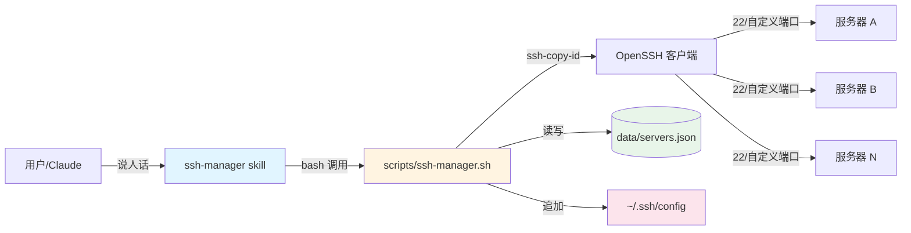
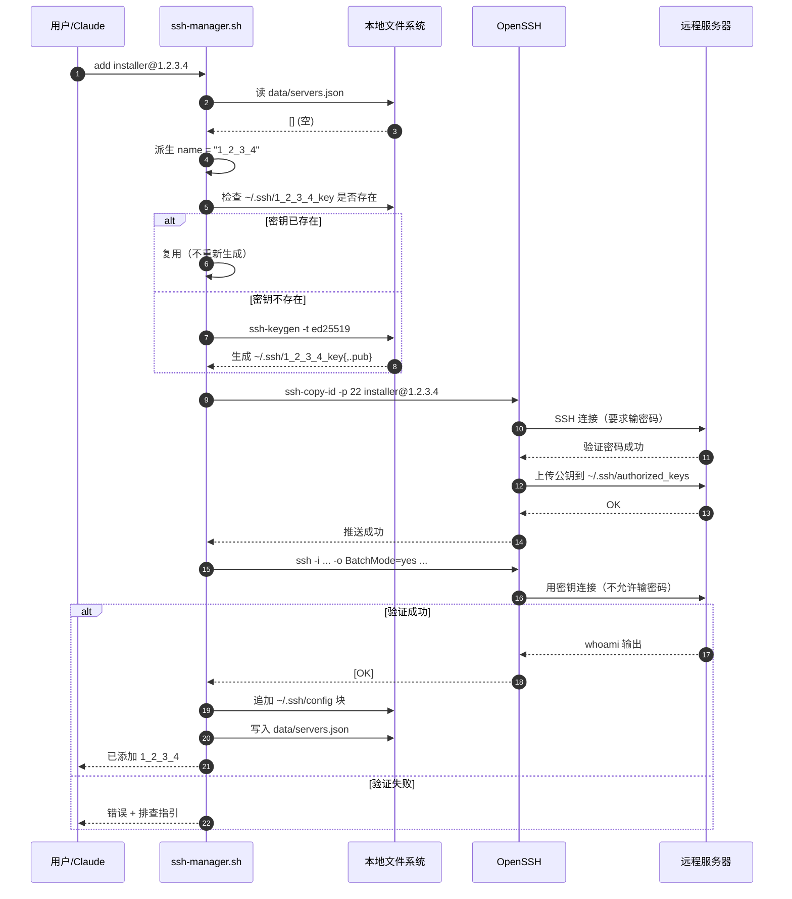
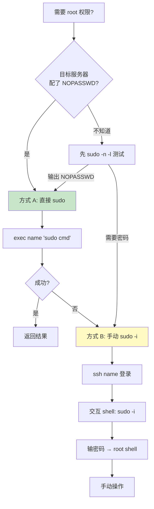
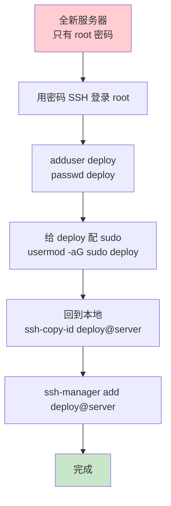

# SSH Manager

免密登录 + 多服务器管理的 Claude Code skill。

> 📖 详细操作说明：见 `SKILL.md`（Claude 的入口）和 `references/`（按需加载）

---

## 这是什么

一个用 Claude Code 管理一组 SSH 服务器的工具。一次添加，终身免密。所有服务器状态存在 `data/servers.json`。

**解决什么**：
- 不用每次手敲 `ssh-copy-id`
- 不用记每台服务器的端口/账号/密钥位置
- 切换 root 用 `sudo -i` 的标准工作流
- Claude 可以代你在多台服务器上执行命令

---

## 工作原理

### 系统架构



**数据流**：用户意图 → skill 解析 → bash 脚本执行 → OpenSSH 联网 → 远程服务器响应 → 结果回到 JSON/config。

### add 命令的完整流程



**关键点**：步骤 8-11 是"真验证"——`BatchMode=yes` 会拒绝密码询问。如果免密不成功，这里就会爆出来，**绝不会假装成功**。

### sudo 工作流决策



---

## 首次使用教学（新服务器配置）

**重要**：skill 不是银弹。第一次添加某台服务器时，需要人工上去做**一次性**的 SSH/sudo 配置。

### 场景 A：你能直接登录服务器（最常见）

#### 步骤 1：确保 sshd 允许密钥登录

登录服务器后，检查：

```bash
sudo grep -E "^(PubkeyAuthentication|PasswordAuthentication|PermitRootLogin)" /etc/ssh/sshd_config
```

需要看到（或者改成）：
```
PubkeyAuthentication yes        # 必须 yes
PasswordAuthentication yes      # 首次推送公钥需要（之后可关）
PermitRootLogin prohibit-password  # 推荐：root 只能用密钥
```

如果改了配置，重启 sshd：
```bash
sudo systemctl restart sshd
```

#### 步骤 2：把首次免密建好（这时 skill 帮不了你，必须人工）

```bash
# 在你的本地机器上：
ssh-copy-id user@server
# 输一次密码 → 以后再连这台就不用密码了
```

#### 步骤 3：让 skill 接管

```bash
ssh-manager add user@server
# skill 会检测到密钥已存在 → 复用
# 然后只验证 + 写 JSON/config，不会再要密码
```

#### 步骤 4：要不要加固？—— 通常不用

到步骤 3 为止，skill **已经能用了**。下面这些**全部可选**，内网机器可以直接跳过。

**做个选择**：

| 你的环境 | 建议 |
|----------|------|
| 内网开发机 | 全跳过，0 成本 |
| 内网生产服务器 | 跳过，反正防火墙挡着 |
| 公网 VPS / 云服务器 | 至少做 #1 |

**#1 关掉密码登录（公网推荐）**

免密建好后，把密码登录关掉才是真正的安全收益：

```bash
sudo sed -i 's/^#\?PasswordAuthentication yes/PasswordAuthentication no/' /etc/ssh/sshd_config
sudo systemctl restart sshd
```

为什么不在一开始就关：`ssh-copy-id` 需要密码登录来验证身份。先开门，进来再上锁。

**#2 配置 sudo NOPASSWD（可选）**

只在你需要 `exec name "sudo systemctl restart nginx"` 这种自动提权时才配。
如果只是偶尔改配置，`ssh-manager ssh name` → `sudo -i` → 输密码反而更安全（每次有显式确认）。

```bash
sudo visudo -f /etc/sudoers.d/<user>-nopasswd
# 加：<user> ALL=(ALL) NOPASSWD: ALL
sudo chmod 0440 /etc/sudoers.d/<user>-nopasswd
```

**#3 禁 root SSH（可选）**

```bash
sudo sed -i 's/^#\?PermitRootLogin yes/PermitRootLogin no/' /etc/ssh/sshd_config
sudo systemctl restart sshd
```

呼应上面的教学：必须用普通用户 + `sudo -i`，符合最小权限原则。

**实用主义**：能用了就别折腾。内网机器全跳过没毛病。

### 场景 B：服务器是全新装的，没有任何用户



具体步骤：

```bash
# 1. 本地用密码登 root
ssh root@server
# 输密码

# 2. 在服务器上：创建普通用户 + 给 sudo
adduser deploy
# 设密码（重要！ssh-copy-id 之前需要这个密码）
usermod -aG sudo deploy

# 3. 退出 root，回到本地
exit

# 4. 本地：首次推送公钥（用 deploy 的密码）
ssh-copy-id deploy@server

# 5. skill 接管
ssh-manager add deploy@server

# 6.（可选）配 NOPASSWD
# 在服务器上：
sudo visudo -f /etc/sudoers.d/deploy-nopasswd
# 加：deploy ALL=(ALL) NOPASSWD: ALL
```

### 场景 C：云服务商买的服务器（VPS）

云厂商通常给你 root 密码 + 控制台 → 走场景 B 的步骤。

**AWS / 阿里云 / 腾讯云**注意：
- 安全组要先放行 22 端口
- 部分云厂商默认禁用 root 密码登录，需要控制台先用密钥登录

---

## sudo -i 是什么？教学

**为什么要 sudo -i？**

SSH 通常给普通用户（如 `installer`、`ubuntu`、`deploy`）免密登录权限，因为 root 权限太大、不应该直接暴露给 SSH。`sudo -i` 是合规的提权方式：

```
installer@server$ whoami
installer
installer@server$ sudo -i
[sudo] password for installer:    ← 这里输你 SSH 用户的密码（不是 root 密码）
root@server# whoami
root
```

**`-i` 标志的意义**：模拟 root 登录 shell，会切换到 root 的家目录 `/root`、加载 root 的环境变量。比 `sudo su` 更干净，比 `sudo bash` 更安全（用 root 的 `.bashrc` 等）。

**两种工作流对比**：

| | 方式 A（exec + sudo） | 方式 B（ssh + sudo -i） |
|--|--|--|
| **何时用** | 单条命令 / 自动化脚本 | 多步操作 / 调试 |
| **前提** | 服务器配了 NOPASSWD | 任何服务器 |
| **例子** | `ssh-manager exec x "sudo systemctl restart nginx"` | `ssh-manager ssh x` → `sudo -i` → 改配置 |
| **优点** | 不需要交互 | 可以用 vim、翻历史、撤销 |
| **缺点** | 没配 NOPASSWD 会卡住 | 需要人工输密码 |

**NOPASSWD 安全说明**：把 `NOPASSWD: ALL` 给某个用户意味着"这个用户随时可以无确认切 root"。安全建议：
- ✅ 只给**运维账号**（deploy、installer）配，不要给应用账号
- ✅ 用 `/etc/sudoers.d/` 独立文件管理，便于审计
- ❌ 不要给 `ALL` 命令无密码，建议只放开特定命令（如 `NOPASSWD: /usr/bin/systemctl *`）

---

## 数据流（一次 add 后，本地发生了什么）

```
~/.ssh/
├── 1_2_3_4_key           ← 新私钥（ed25519，无密码短语）
└── 1_2_3_4_key.pub       ← 新公钥

~/.ssh/config             ← 追加了一段：
                            Host 1.2.3.4
                                HostName 1.2.3.4
                                Port 22
                                User installer
                                IdentityFile ~/.ssh/1_2_3_4_key
                                IdentitiesOnly yes

~/.claude/skills/ssh-manager/data/servers.json
                            ← 追加了一条：
                            { "name": "1_2_3_4", "host": "1.2.3.4", ... }

服务器上：~/.ssh/authorized_keys
                            ← 多了一行：
                            ssh-ed25519 AAAA... user@local
```

**可清理**：删除服务器时，skill 只清 JSON。手动清理：
```bash
rm ~/.ssh/<name>_key*                  # 删密钥
# 编辑 ~/.ssh/config，删对应 Host 块
```

---

## 故障排查快速索引

| 症状 | 可能原因 | 解决 |
|------|----------|------|
| ssh-copy-id 卡住 | 网络/防火墙/账号错 | 见 `references/troubleshooting.md` |
| BatchMode 验证失败 | authorized_keys 权限不对 | `chmod 600 ~/.ssh/authorized_keys` |
| sudo 要求密码 | 没配 NOPASSWD | 配 sudoers.d/（见上文）|
| 列表显示空但 JSON 有数据 | （已修复）Python 路径 | 升级到最新 skill 即可 |

详细排查流程见 `references/troubleshooting.md`。

---

## 进阶话题

- **多用户共用**：把 `data/servers.json` 和 `~/.ssh/*.key` 放进 git 仓库，团队共享（**注意：私钥绝对不能进 git！只共享 servers.json**）
- **端口转发 / 跳板机**：在 `~/.ssh/config` 里改 Host 块加 `ProxyJump` / `LocalForward`，skill 不需要改
- **密钥轮转**：删除旧 key → `ssh-manager add` 时会复用旧 name 生成新 key（注意：需要先把服务器上的 `authorized_keys` 里旧 key 删掉）
- **Ansible 替代**：如果你管 50+ 台、需要在所有机器上同时执行，Ansible 更合适。这个 skill 是 1-20 台的人肉运维友好工具
